# 개발 작업실 구축 미션

## 1. 프로젝트 소개

WSL2의 Ubuntu에서 Docker를 사용해 Nginx 기반 웹페이지를 빌드하고 실행했다. 포트 매핑으로 브라우저 접속을 확인하고, 바인드 마운트와 Docker 볼륨으로 파일 반영 및 데이터 영속성을 실습했다.

## 2. 실행 환경

- OS: Windows + WSL2 Ubuntu 26.04.1 LTS
- WSL: 3.0.3.0
- Shell: Ubuntu 터미널
- Docker: 29.9.2
- Git: 2.53.0
- 편집기: Visual Studio Code, WSL 확장 사용

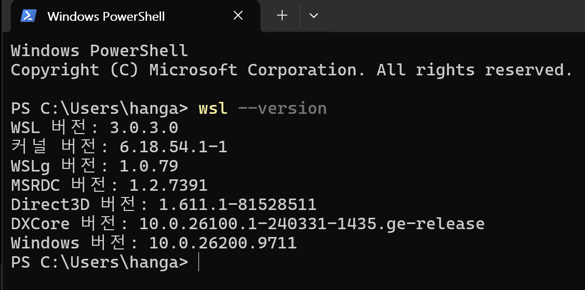
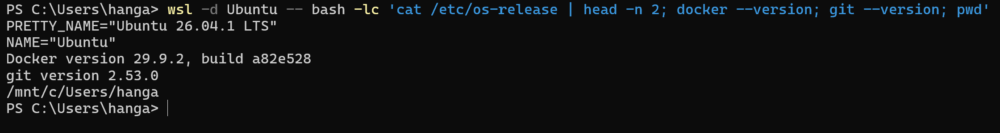

## 3. 프로젝트 구조

| 경로 | 역할 |
|---|---|
| `Dockerfile` | Nginx 커스텀 이미지 빌드 설정 |
| `site/index.html` | Nginx가 제공하는 웹페이지 |
| `evidence/` | 실습 결과 스크린샷 |
| `practice/` | 터미널 명령 및 권한 실습 파일 |

프로젝트와 실습 파일은 Linux 홈 디렉터리 아래에 두었다.

```text
/home/hangang2221/projects/dev-workstation-mission
```

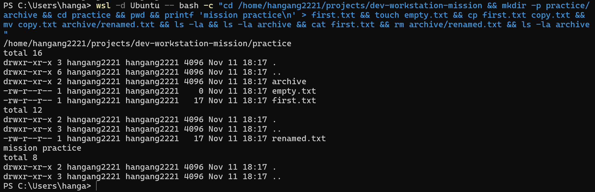

## 4. 터미널 기본 조작

`pwd`, `ls -la`, `mkdir`, `touch`, `cat`, `cp`, `mv`, `rm`을 사용해 현재 위치 확인, 파일·폴더 생성, 내용 확인, 복사, 이동 및 삭제를 실습했다.

```bash
pwd
ls -la
mkdir -p practice/evidence-run/archive
cd practice/evidence-run
echo 'sample content' > first.txt
touch empty.txt
cp first.txt copy.txt
mv copy.txt archive/renamed.txt
cat first.txt
rm archive/renamed.txt
```

`cat first.txt`에서 `sample content`를 확인했고, 삭제 후 `archive` 폴더가 비어 있는 것을 확인했다.

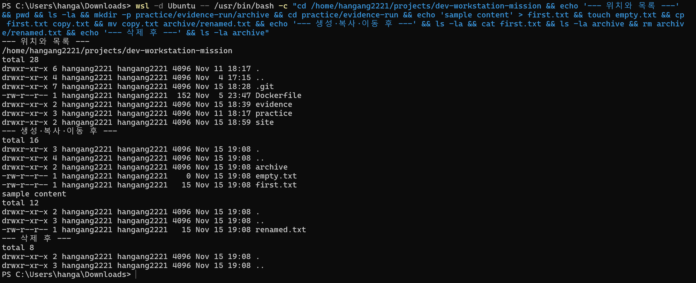

## 5. Linux 파일 권한

파일과 디렉터리의 권한을 변경하고 `ls -l`로 결과를 확인했다. `600`과 `700`으로 변경한 뒤 일반적인 파일 권한 `644`, 디렉터리 권한 `755`로 복구했다.

```bash
chmod 600 practice/first.txt
chmod 700 practice/archive
ls -ld practice/first.txt practice/archive

chmod 644 practice/first.txt
chmod 755 practice/archive
ls -ld practice/first.txt practice/archive
```

- `644`: 소유자는 읽기·쓰기, 그룹과 기타 사용자는 읽기
- `755`: 소유자는 읽기·쓰기·실행, 그룹과 기타 사용자는 읽기·실행
- 디렉터리의 `x` 권한은 디렉터리 안으로 접근하는 데 필요하다.

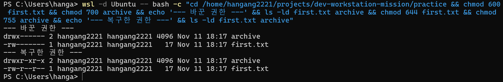


## 6. Docker 설치 및 기본 점검

Docker 버전과 엔진 연결 상태를 확인했다. `docker info`의 Server 항목에서 엔진 버전과 Linux 서버 정보를 확인했다.

```bash
docker --version
docker info
docker images
docker ps -a
docker logs <hello-world-컨테이너-ID>
docker stats --no-stream ubuntu-persistent
```

`docker stats` 실행 당시 `ubuntu-persistent` 컨테이너의 CPU와 메모리 사용량이 출력됐다.

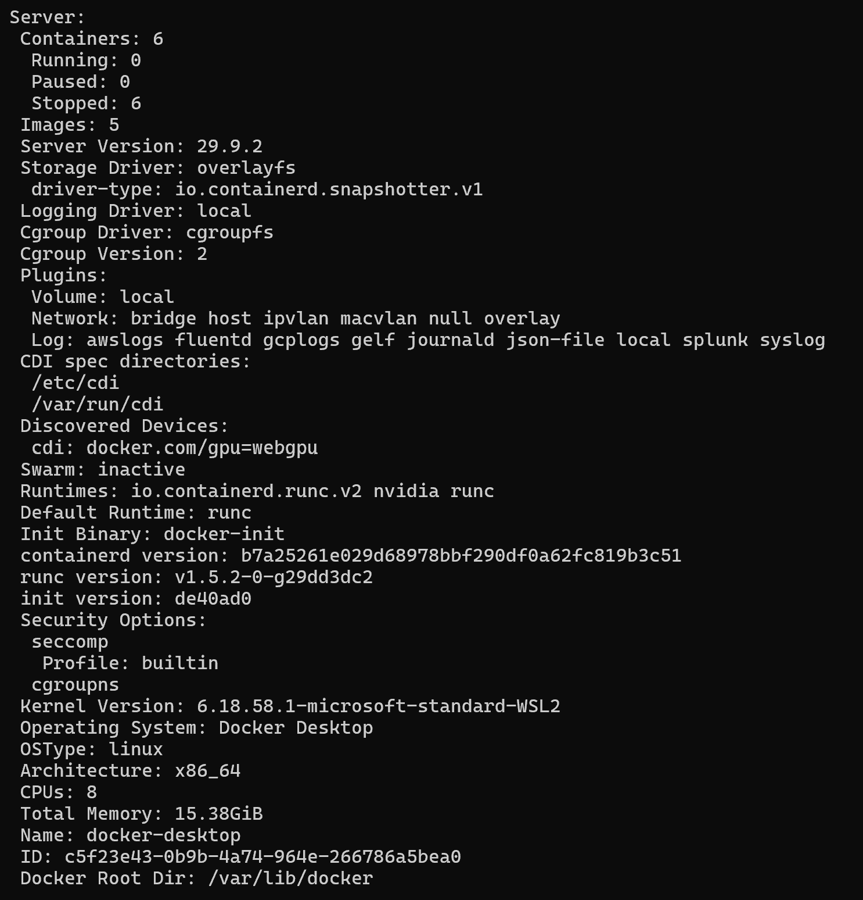
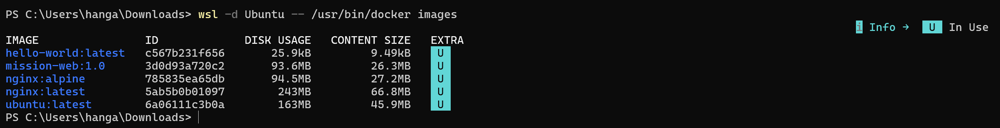
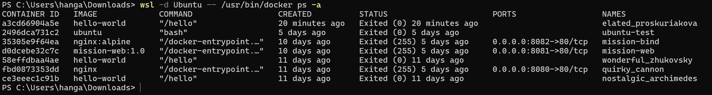
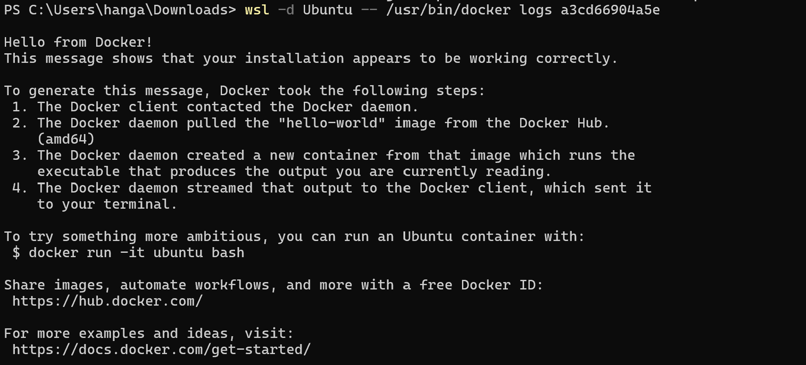
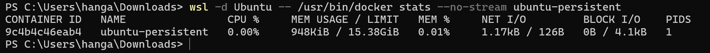

## 7. 컨테이너 실행 및 관리

### hello-world

```bash
docker run hello-world
```

`Hello from Docker!`가 출력되어 Docker 클라이언트와 엔진의 연결 및 컨테이너 실행을 확인했다.

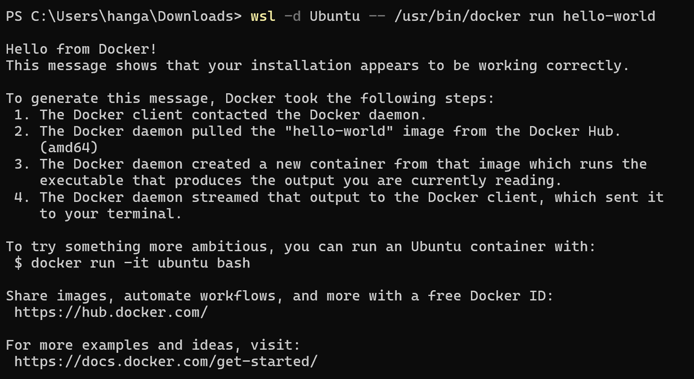

### Ubuntu 컨테이너

```bash
docker run --name ubuntu-practice -it ubuntu bash
```

컨테이너 안에서 `ls`로 파일시스템을 확인하고 `echo container-ok`를 실행했다. 이 셸에서 `exit`하자 컨테이너 상태가 `Exited (0)`으로 바뀌었다.

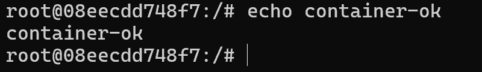
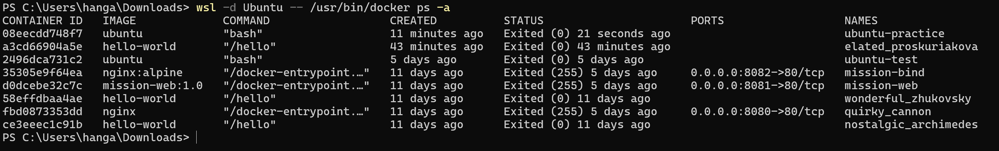

### exec와 attach 비교

`ubuntu-persistent`를 백그라운드에서 실행한 다음 `docker exec`로 새 셸을 열었다. 새 셸에서 `exit`해도 컨테이너의 메인 프로세스는 계속 실행됐다. `docker attach`로 메인 프로세스에 연결한 뒤 `Ctrl+P`, `Ctrl+Q`를 눌러 연결만 끊었고, 컨테이너 상태가 계속 `Up`인 것을 확인했다.

```bash
docker run -dit --name ubuntu-persistent ubuntu bash
docker exec -it ubuntu-persistent bash
docker ps --filter name=ubuntu-persistent
docker attach ubuntu-persistent
```

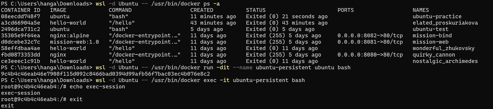
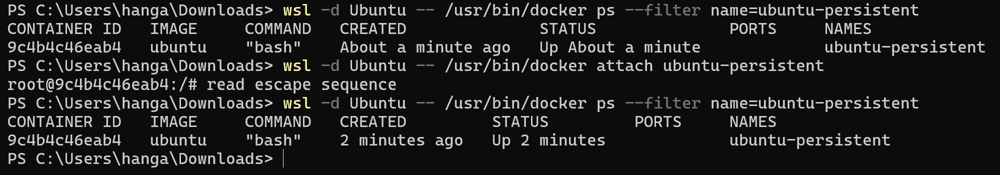

## 8. Dockerfile 커스텀 이미지

기존 베이스 이미지 `nginx:alpine`에 프로젝트의 정적 HTML을 복사해 커스텀 이미지를 만들었다.

```dockerfile
FROM nginx:alpine
LABEL org.opencontainers.image.title="dev-workstation-mission"
ENV APP_ENV=development
COPY site/ /usr/share/nginx/html/
EXPOSE 80
```

- `FROM`: 가벼운 Nginx Alpine 이미지를 기반으로 사용
- `LABEL`: 이미지의 프로젝트 이름을 기록
- `ENV`: 컨테이너 환경변수 `APP_ENV` 설정
- `COPY`: `site/`의 웹 파일을 Nginx 기본 웹 경로로 복사
- `EXPOSE 80`: 컨테이너가 사용하는 포트를 문서화

```bash
docker build -t mission-web:1.0 .
```

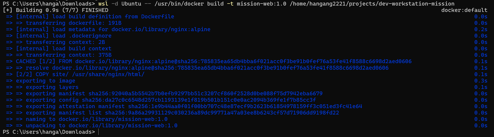

## 9. 포트 매핑 웹 접속

호스트의 `8081` 포트와 컨테이너의 `80` 포트를 연결했다. 브라우저에서 `http://localhost:8081`로 접속해 페이지를 확인했다.

```bash
docker run -d --name mission-web-proof -p 8081:80 mission-web:1.0
```

`-p 호스트포트:컨테이너포트` 형식으로 포트를 연결한다. 컨테이너 포트만 지정하면 호스트 브라우저에서 바로 접근할 수 없기 때문에 포트 매핑이 필요하다.

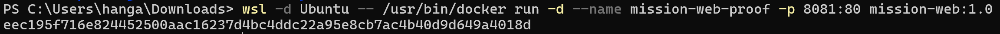
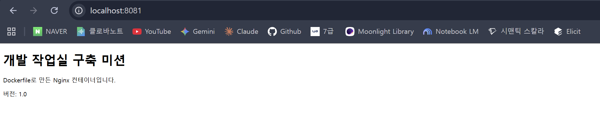

## 10. 바인드 마운트 변경 반영

WSL 프로젝트의 `site` 디렉터리를 Nginx 컨테이너의 웹 루트에 연결했다. 호스트의 `site/index.html`에서 버전을 `1.0`에서 `1.1`로 바꾸고 브라우저를 새로고침해, 이미지를 다시 빌드하지 않아도 변경이 반영되는 것을 확인했다.

```bash
docker run -d --name mission-bind-proof \
  -p 8082:80 \
  -v /home/hangang2221/projects/dev-workstation-mission/site:/usr/share/nginx/html:ro \
  nginx:alpine
```

`:ro`는 컨테이너에서 마운트된 파일을 읽기 전용으로 사용한다는 뜻이다. 호스트 파일 편집은 가능하다.

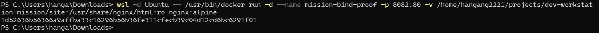
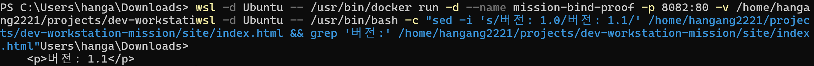
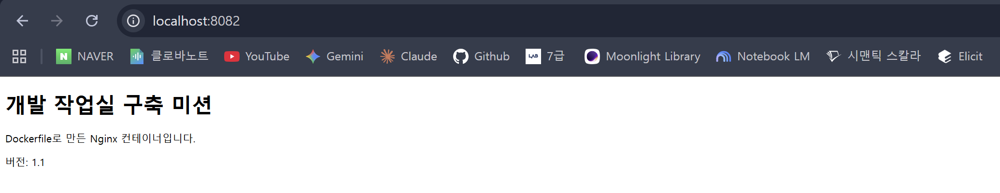

## 11. Docker 볼륨 영속성

이름 있는 볼륨 `mission-data`를 만들고 `volume-writer` 컨테이너의 `/data`에 연결했다. 파일을 작성한 뒤 컨테이너를 삭제하고, 새 `volume-reader` 컨테이너에서 같은 파일을 읽었다. 컨테이너 삭제 후에도 볼륨의 데이터가 유지되는 것을 확인했다.

```bash
docker volume create mission-data
docker run -d --name volume-writer -v mission-data:/data ubuntu sleep infinity
docker exec volume-writer sh -c "echo volume-survived > /data/proof.txt && cat /data/proof.txt"
docker rm -f volume-writer
docker run --name volume-reader -v mission-data:/data ubuntu cat /data/proof.txt
```

마지막 명령에서 `volume-survived`가 출력됐다. 컨테이너의 생명주기와 볼륨의 생명주기는 별개다.

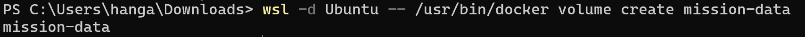
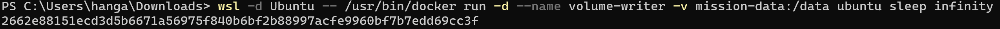
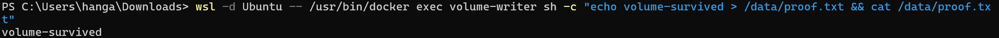
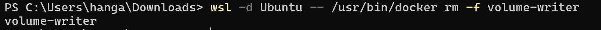
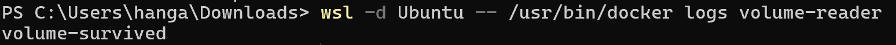

## 12. Git 및 GitHub 연결

기본 브랜치를 `main`으로 설정하고 GitHub 저장소 `Ricecake132/dev-workstation-mission`을 원격 저장소 `origin`으로 연결했다. GitHub CLI 브라우저 인증 후 Git 인증에 연결했다. 토큰은 원격 주소나 README에 저장하지 않는다.

```bash
git config --global --list
git status --short --branch
git remote -v
gh auth status
```

인증 정보는 공개하지 않도록 Git 설정 캡처의 이메일을 가렸다. 원격 주소에는 토큰이 포함되지 않은 HTTPS 주소를 사용한다.


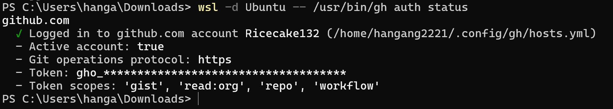
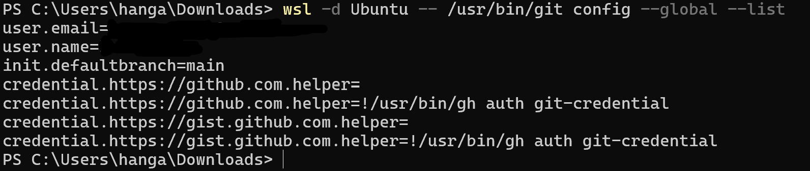

## 13. 트러블슈팅

### 사례 1: Docker API에 연결할 수 없음

- 문제: `docker` 명령이 `npipe`의 Docker API에 연결하지 못함
- 원인: Ubuntu에서 Windows용 Docker CLI와 `desktop-linux` 컨텍스트를 사용하거나, Docker Desktop의 WSL 연결 파일이 아직 Ubuntu에 마운트되지 않은 상태였음
- 확인: `/usr/bin/docker`가 Docker Desktop의 WSL CLI를 가리키는지 확인하고 `docker info`의 `Server` 정보 확인
- 해결: Docker Desktop에서 Ubuntu WSL 통합을 켜고 WSL/Docker Desktop을 재시작한 뒤 `/usr/bin/docker`로 엔진을 확인

### 사례 2: Nginx가 403 Forbidden을 반환함

- 문제: 브라우저에서 Nginx 403 Forbidden이 표시됨
- 원인: 바인드 마운트 대상인 `site/` 안에 `index.html`이 없고, 파일이 프로젝트 루트에 있었음
- 확인: `site/index.html` 경로와 컨테이너에 연결한 호스트 디렉터리 확인
- 해결: HTML을 `site/index.html`로 옮기고 컨테이너를 재시작해 브라우저에서 다시 확인

## 14. 핵심 개념 정리

- 이미지는 컨테이너를 만들 때 사용하는 실행 템플릿이고, 컨테이너는 이미지로 실행된 인스턴스다.
- 포트 매핑은 호스트 포트와 컨테이너 포트를 연결해 브라우저 접근을 가능하게 한다.
- 바인드 마운트는 호스트의 특정 경로를 컨테이너 경로에 연결한다.
- Docker 볼륨은 컨테이너를 삭제해도 데이터를 유지할 수 있도록 별도로 관리하는 저장소다.
- 파일 권한 `644`는 일반 파일, `755`는 디렉터리에 자주 쓰이며, 각 숫자는 읽기(4)·쓰기(2)·실행(1)의 합이다.

## 15. 제출 전 체크리스트

- [x] WSL2 Ubuntu 및 개발 도구 버전 확인
- [x] 터미널 파일·폴더 조작
- [x] 파일 및 디렉터리 권한 변경
- [x] Docker 엔진, 이미지, 컨테이너, 로그, 리소스 확인
- [x] hello-world 및 Ubuntu 컨테이너 실습
- [x] Dockerfile 이미지 빌드 및 포트 접속
- [x] 바인드 마운트 변경 반영 확인
- [x] 볼륨 데이터 영속성 확인
- [x] Git 설정 및 GitHub CLI 로그인
- [ ] README와 모든 스크린샷을 GitHub 저장소에 커밋·푸시